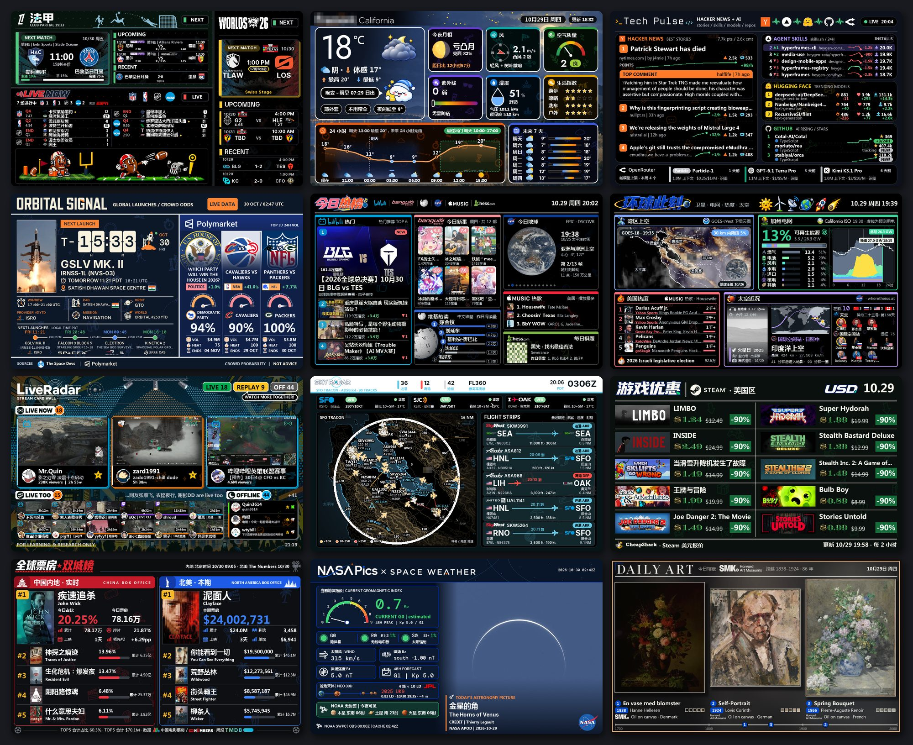

<div align="center">


# EpaperSystem · ColoredEpaper Frame

**把天气、日程、赛事、新闻和你在意的一切，装进一块会自己换页的彩色墨水屏。**

Raspberry Pi + 六色墨水屏 · 71 个插件自动轮播 · 局域网网页管理 · **一行命令安装** · 可选字体 DLC

</div>



<p align="center"><sub>以上都是设备 2026 年 10 月 29 日刚刷新的实机画面（800 × 480，六色墨水屏），个人信息已打码。</sub></p>

## 它会显示什么

| 主题 | 内容 |
|---|---|
| 🌤 **天气与日历** | 现代天气页：插画随天气和昼夜变化，夜里换成星空，每张卡片有自己的底纹，“明天”的时间直接写明天；节假日、个人日程与发布会日历 |
| ⚽ **体育与电竞** | 足球、NFL、MLB、NBA / WNBA、NHL、F1、PGA 各有专属版式和球场插画，直播优先、多场同时进行时变成比分墙；比赛场馆用官方 logo（200 余座），季后赛和总决赛有系列赛进度；LoL / CS2 / Dota 赛事与赔率，LoL / CS2 职业选手轮播 |
| 📰 **资讯与科技** | 整点新闻（AI 摘要，国内 / 国际双栏）、全网热搜（百度 / 头条 / 知乎 / 抖音，可加微博）、Hacker News 与 AI 榜单（含 OpenRouter 新模型）、Telegram 精选、科技与游戏、今日热榜（B 站 / 新番 / 维基 / 热歌 / 棋题 / NASA 地球） |
| 🎮 **游戏与影视** | Steam 资料与好友（好友在玩的游戏截图）、Steam 排行与每日美图、游戏优惠（Steam 简体中文名）、直播雷达、全球票房双城榜 |
| 🚀 **太空与天空** | NASA 每日天文图、空间天气与近地小行星（JPL）、今夜可见行星、火箭发射倒计时与预测市场、环球此刻（卫星云图、加州电网、火星照片、空间站与在轨航天员）、机场航班雷达 |
| 🎨 **艺术与知识** | 每日名画、历史海报、杂志与漫画封面、今日报纸头版、维基每日、每日一词 |
| 📍 **生活与本地** | 湾区预警地图、路况摄像头、出行与潮汐、身边物种、本地活动、3D 打印监控、车辆状态、资金雷达与持仓看板、世界赔率榜（Polymarket / Kalshi 预测市场） |

## 为什么好用

- **自己会换页**：按播放列表自动轮播，白天 / 夜间主题自动切换，天气等页面在上屏前即时刷新。
- **装好就有内容**：新设备首次启动自带 9 页无需 API Key、也不依赖位置的入门轮播。
- **好看**：数据来源用官方 logo，每个版块有按内容生成的低调底纹和插画，小字保持纯黑，墨水屏上也清楚。
- **网页管理**：局域网打开即可管理插件和播放列表，首页实时显示当前画面，iPhone 可加到主屏幕。
- **稳定**：数据源不可用时先显示缓存再自动重试；内存紧张时较重的刷新自动让路，轮播照常；断网自恢复；更新失败会回到上一版本。

## 从零装好：照着做，不用想

### 先准备这些

| 东西 | 选哪个 |
|---|---|
| 树莓派 | Raspberry Pi Zero 2 W（或更新的型号） |
| 墨水屏 | Waveshare 7.3 寸六色墨水屏 HAT (E)（型号 `epd7in3e`） |
| 存储卡 | microSD 卡，16 GB 或更大 |
| 电源 | 树莓派官方电源 |
| 电脑 | 任意 Windows / Mac，和树莓派连**同一个 Wi-Fi** |

> 用的是别的屏幕也能装（其他 Waveshare 或 Pimoroni Inky），第 4 步会多问一句。

### 第 1 步：给存储卡写系统

1. 电脑上安装并打开 [Raspberry Pi Imager](https://www.raspberrypi.com/software/)。
2. 设备选你的树莓派；系统选 **Raspberry Pi OS (other) → Raspberry Pi OS Lite (64-bit)**；存储选你的 microSD 卡。
3. 出现“自定义设置 / 编辑设置”时，**照抄下面这几项**，其他不用动：
   - 主机名：`epaper`
   - 用户名：`pi`，密码：自己定一个并**记下来**
   - Wi-Fi：填家里的 Wi-Fi 名称和密码（树莓派 Zero 只能连 **2.4 GHz** Wi-Fi）
   - 打开 **SSH**，选“使用密码登录”
4. 点写入，等它写完、校验完再拔卡。

### 第 2 步：装好屏幕，开机

把墨水屏插到树莓派的排针上，插入存储卡，接上电源。**等 3 分钟**，让它第一次开机连上 Wi-Fi。

### 第 3 步：从电脑连上树莓派

1. 打开终端：Windows 在开始菜单搜索 **PowerShell**；Mac 打开 **终端**。
2. 输入下面这行，回车：

   ```bash
   ssh pi@epaper.local
   ```

3. 问 `Are you sure you want to continue connecting` 时，输入 `yes` 回车。
4. 输入第 1 步记下的密码，回车。**输入密码时屏幕上不显示任何字符，这是正常的。**

### 第 4 步：粘贴这一行命令

```bash
curl -fsSL https://raw.githubusercontent.com/Feeengyuuu/EpaperSystem/main/install.sh | sudo bash -s -- --lang zh-CN
```

粘贴（Windows 在窗口里点右键，Mac 按 ⌘V）后回车。装的过程中**只会问两件事**：

| 屏幕上出现 | 你要做的 |
|---|---|
| `选择 1/2/3 [1]` | **直接按回车**（= 7.3 寸六色屏）。只有用别的屏幕才选 2 或 3 |
| `现在配置 API Key 吗？` | **直接按回车**跳过，以后在网页里填 |
| 要求输入 `password` | 输入第 1 步的密码 |

剩下的全自动：下载程序、装依赖、装开源字体包、启动服务、自检。树莓派 Zero 比较慢，可能要等几十分钟，**中途别关窗口、别断电**。

### 第 5 步：设置网页密码

装完后终端会显示访问地址和一行读取配对码的命令。

1. 在终端运行这一行，复制它显示的配对码：

   ```bash
   sudo cat /var/lib/inkypi/data/security/bootstrap_admin.token
   ```

2. 手机或电脑浏览器打开 **http://epaper.local/auth/setup**，粘贴配对码，设一个管理密码。

### 第 6 步：重启一次

```bash
sudo reboot
```

几分钟后屏幕开始显示入门轮播。**墨水屏换一页要几十秒、会闪几下，这是正常的。**以后在 **http://epaper.local** 管理插件和播放列表。

### 可选：给插件填 API Key

大部分插件不用 Key。下面这些点链接注册（大多免费），拿到后粘贴到 **http://epaper.local/api-keys**：

[资金雷达 · Finnhub](https://finnhub.io/dashboard) · [资金雷达 · FRED](https://fredaccount.stlouisfed.org/apikeys) · [湾区德鲁伊 · eBird](https://ebird.org/api/keygen) · [湾区要紧事 · NASA FIRMS](https://firms.modaps.eosdis.nasa.gov/api/map_key/) · [科技与游戏 / LiveRadar · Twitch](https://dev.twitch.tv/console/apps) · [Sky Radar · FlightAware](https://flightaware.com/aeroapi/portal/) · [全球票房 · TMDB](https://www.themoviedb.org/settings/api) · [本地活动 · Ticketmaster](https://developer.ticketmaster.com/products-and-docs/apis/getting-started/) · [漫画封面 · Comic Vine](https://comicvine.gamespot.com/api/) · [CS2 赛事 · PandaScore](https://app.pandascore.co/signup) · [天气 · OpenWeather](https://home.openweathermap.org/api_keys) · [整点新闻 · Groq](https://console.groq.com/keys)

全网热搜的微博榜填登录 [weibo.com](https://weibo.com/) 后的 `SUB` Cookie。全部 Key 见 [API Key 获取](inkypi-weather/package/InkyPi/docs/api_keys.zh-CN.md)。

### 以后想更新

SSH 连上后，把第 4 步那行命令**原样再跑一次**就是更新到最新版；配置、轮播和密钥都会保留。

<details>
<summary>卡住了？点这里</summary>

- **`ssh pi@epaper.local` 连不上**：再等 2 分钟重试；仍不行就检查第 1 步的 Wi-Fi 名称和密码（区分大小写、必须是 2.4 GHz），重新写卡。
- **`epaper.local` 打不开**：用安装结束时终端里显示的 `http://192.168.x.x` 那个地址；手机或电脑要和树莓派在同一个 Wi-Fi。
- **配对码过期**：运行 `sudo inkypi admin bootstrap` 生成新的。
- **安装中途断了**：重新连上，把第 4 步的命令再粘贴一次，会接着装。
- **屏幕一直没反应**：断电，确认屏幕插牢在排针上，再开机；然后运行 `sudo bash /opt/inkypi/current/install/healthcheck.sh --lang zh-CN --wait 120` 看诊断。
- 想从空播放列表开始：命令末尾加 `--no-starter`；不要开源字体包：加 `--no-font-dlc`；English installer: `--lang en`。

</details>

## 字体 DLC（可选，不装也能用）

部分页面会用联赛、电竞赛事或品牌自己的字体来显示比分和标题。这些字体**不随项目分发**，作为“字体 DLC”单独安装；没装的页面自动用项目自带的字体，功能完全一样。

- **开源字体包**：一行命令安装时**已经自动装好**（8 款，约 180 KB）。想手动重装：`sudo inkypi fonts install --open`
- **看看装了哪些**：`sudo inkypi fonts list`
- **商业字体**：在下表的授权渠道买到授权后，把字体文件拷到树莓派（例如 `scp Knockout-49.woff2 pi@epaper.local:~/`），再运行 `sudo inkypi fonts add nba ~/Knockout-49.woff2`
- **删掉一款**：`sudo inkypi fonts remove <名称>`

装好的字体在页面下次刷新时生效。所有字体都由同一个检查程序把关：只认固定文件名、不超过 2 MiB、数字必须清晰可读。

**开源字体（自动安装，可直接下载）**

| 名称 | 字体 | 用在哪 | 许可 | 下载 |
|---|---|---|---|---|
| `seriea` | Bai Jamjuree Bold | 意甲比分 | SIL OFL 1.1 | [文件](https://cdn.jsdelivr.net/npm/@fontsource/bai-jamjuree@5.3.0/files/bai-jamjuree-latin-700-normal.woff2) · [主页](https://fonts.google.com/specimen/Bai+Jamjuree) |
| `esports-riot` | Inter Bold | LoL 赛事比分 | SIL OFL 1.1 | [文件](https://cdn.jsdelivr.net/npm/@fontsource/inter@5.3.0/files/inter-latin-700-normal.woff2) · [主页](https://rsms.me/inter/) |
| `esports-riot-regular` | Inter Regular | LoL 赛事正文 | SIL OFL 1.1 | [文件](https://cdn.jsdelivr.net/npm/@fontsource/inter@5.3.0/files/inter-latin-400-normal.woff2) · [主页](https://rsms.me/inter/) |
| `esports-cct-event` | IBM Plex Sans SemiBold | CCT 赛事 | SIL OFL 1.1 | [文件](https://cdn.jsdelivr.net/npm/@fontsource/ibm-plex-sans@5.3.0/files/ibm-plex-sans-latin-600-normal.woff2) · [主页](https://github.com/IBM/plex) |
| `esports-dust2-event` | Blinker Bold | Dust2.dk / POWER Ligaen | SIL OFL 1.1 | [文件](https://cdn.jsdelivr.net/npm/@fontsource/blinker@5.3.0/files/blinker-latin-700-normal.woff2) · [主页](https://fonts.google.com/specimen/Blinker) |
| `esports-montserrat-event` | Montserrat（可变字重） | European Pro League 等 | SIL OFL 1.1 | [文件](https://cdn.jsdelivr.net/npm/@fontsource-variable/montserrat@5.3.0/files/montserrat-latin-wght-normal.woff2) · [主页](https://github.com/JulietaUla/Montserrat) |
| `esports-roboto-event` | Roboto Bold | StarLadder / Thunderpick | SIL OFL 1.1 | [文件](https://cdn.jsdelivr.net/npm/@fontsource/roboto@5.3.0/files/roboto-latin-700-normal.woff2) · [主页](https://fonts.google.com/specimen/Roboto) |
| `esports-tesla-event` | Anek Latin Bold | Tesla Cup | SIL OFL 1.1 | [文件](https://cdn.jsdelivr.net/npm/@fontsource/anek-latin@5.3.0/files/anek-latin-latin-700-normal.woff2) · [主页](https://fonts.google.com/specimen/Anek+Latin) |

<details>
<summary>商业字体与品牌专用字体（需自备授权）</summary>

**商业字体**：可在授权渠道购买，再用 `sudo inkypi fonts add <名称> <文件>` 安装。

| 名称 | 字体 | 用在哪 | 授权渠道 |
|---|---|---|---|
| `nba` | Knockout 49 Liteweight | NBA 比分 | [Hoefler&Co.](https://myfonts.com/collections/knockout-font-hoefler-and-co) |
| `esports-cs2` | Stratum 2 Bold | CS2 标题与比分 | [Process Type Foundry](https://processtypefoundry.com/fonts/stratum-1-and-2) |
| `esports-cs2-regular` | Stratum 2 Medium | CS2 正文 | [Process Type Foundry](https://processtypefoundry.com/fonts/stratum-1-and-2) |
| `esports-blast` | TT Norms Pro Bold | BLAST 赛事 | [TypeType](https://www.fontspring.com/fonts/typetype/tt-norms-pro) |
| `esports-pgl-event` | FF DIN Pro Bold | PGL 赛事 | [FontFont（Monotype）](https://www.myfonts.com/collections/albert-jan-pool/) |
| `esports-industry-event` | Industry Bold | CS 亚洲邀请赛等 | [Fort Foundry](https://www.youworkforthem.com/font/T5020/industry) |

**品牌专用字体**：联赛和赛事方定制，不对外发售授权，本项目不提供下载。不装时用自带字体。

| 名称 | 字体 | 用在哪 |
|---|---|---|
| `wnba` | WNBA Condensed Bold | WNBA 比分 |
| `mls` | MLS Tifo Bold | 美职联比分 |
| `epl` | Premier League Bold | 英超比分 |
| `laliga` | LALIGA Headline Std Bold | 西甲比分 |
| `bundesliga` | DFL Web Bold | 德甲比分 |
| `f1` | Formula1 Display Bold | F1 积分与计时 |
| `esports-dota` / `esports-dota-regular` | Radiance Bold / Semibold | Dota 2 |
| `esports-riot-heading` | Riot Sans Bold | LoL 赛事标题 |
| `lol_pro_heavy` / `lol_pro_bold` / `lol_pro_medium` | Beaufort for LOL Heavy / Bold / Medium | LoL 职业选手页 |
| `esports-esl-heading` / `esports-iem-heading` | ESL Legendary / ESL Legend Bold | ESL / IEM 标题 |

**版权方待确认**：`ligue1`（Insatiable Display，法甲比分）、`esports-blast-heading`（Radion A，BLAST 标题）、`esports-gear-event`（Gear，电竞世界杯）、`game_deals_price`（Banknote，游戏优惠价签，仅 TTF）。没找到公开授权渠道，只有你自己持有授权文件时才用 `add` 安装。

微软雅黑随 Windows 授权、不随项目分发；没有它时中文界面用项目自带的开源 Noto Sans SC。完整清单在 [`font_dlc.json`](inkypi-weather/package/InkyPi/install/font_dlc.json)。

</details>

## 手动安装、文档与开发

<details>
<summary>展开</summary>

```bash
git clone --depth 1 https://github.com/Feeengyuuu/EpaperSystem.git
cd EpaperSystem
bash install.sh --lang zh-CN --check   # 只做环境检查
sudo bash install.sh --lang zh-CN
```

- [从零安装](inkypi-weather/package/InkyPi/docs/install_from_zero.zh-CN.md) · [Installation guide](inkypi-weather/package/InkyPi/docs/install_from_zero.md) · [API Key 获取](inkypi-weather/package/InkyPi/docs/api_keys.zh-CN.md) · [API keys](inkypi-weather/package/InkyPi/docs/api_keys.md)
- [开发与本地测试](docs/development.md) · [编写插件](inkypi-weather/package/InkyPi/docs/building_plugins.md)
- 应用、插件和测试在 `inkypi-weather/package/InkyPi`（开发与 CI 用 Python 3.11，九千多项测试用模拟硬件运行；设备上用 Raspberry Pi OS 自带的 Python），手机简报页与车辆授权 Worker 在 `cloudflare/`。

</details>

## 致谢与许可

基于开源项目 [InkyPi](https://github.com/fatihak/InkyPi) 构建，感谢原作者与社区。InkyPi 部分以 **GPL-3.0** 发布，见 [LICENSE](inkypi-weather/package/InkyPi/LICENSE)。字体 DLC 中的字体版权归各自所有者，开源字体按各自许可（SIL OFL 1.1）使用。

<sub>An open-source Raspberry Pi colour e-paper dashboard: 71 plugins for weather, calendars, sports, news, games, space and local life, auto-rotating with a web UI. Install with the one command above (`--lang en` for English). Optional fonts install as a font DLC: `sudo inkypi fonts list`.</sub>
