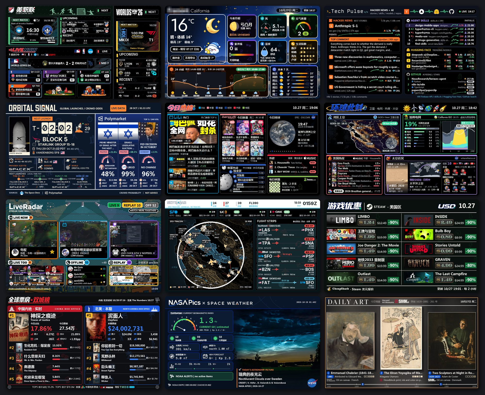

# EpaperSystem · ColoredEpaper Frame


EpaperSystem 是基于 **Raspberry Pi + 彩色墨水屏** 的开源信息站，网页和手机端以 **ColoredEpaper Frame** 为品牌。它把天气、日程、赛事、新闻和你关注的内容集中在一块 800 × 480 的六色墨水屏上，近 70 个插件按播放列表自动轮播，通过局域网网页管理。

An open-source Raspberry Pi colour e-paper dashboard (ColoredEpaper Frame) with nearly 70 plugins for weather, calendars, sports, news, games, space and local life, a one-command installer, a starter rotation that works without API keys, and a web interface for playlists.

## 最新实机画面



以上是设备在 2026 年 10 月实际显示的画面（隐私信息已处理）。部分内容需要配置第三方服务或 API Key。

## 内容

- **天气与日历**
  - 天气在上屏前重新取数，现代仪表盘版式：场景插画随天气和昼夜变化，配日出日落、风向罗盘、空气质量表盘、24 小时与 7 天曲线；也可切回经典版。
  - 日历整合节假日、个人日程、苹果与游戏发布会。今天的日期落着一滴血，过去的日子被红色马克笔随手划掉。左栏的漫画主持人按节日、日程、天气和时段换人换装，用中文气泡做倒计时、节日问候和发薪日提醒。
- **体育**：一页三个区域，每个赛事有自己的版式。
  - 上方足球：欧洲五大联赛、中超、世界杯与国家队比赛，附赔率、积分和后续赛程。
  - 左下赛事：NFL 转播式记分牌、MLB 每局比分、NBA / WNBA 对阵与系列赛、NCAA 前 25 名、PGA 排行榜，以及 F1 页（车队官方队标与发车格、领奖台名次、每站对应的赛道图和赛道信息）。按比赛状态与赛事级别打分排序，多场同时直播时显示比分墙并轮换露面。
  - 右侧电竞：英雄联盟 LPL / LCK / MSI / 世界赛、CS2、Dota 2 TI，直播优先，大赛在比赛日置顶。
- **资讯与科技**
  - 整点新闻：AI 摘要的头条加国内、国际两栏，底部 A 股与美股行情条按各市场习惯着色。
  - 技术圈与 AI 脉搏：Hacker News 与 AI 技能、模型、开源仓库三个榜单合一，自建小时快照计算涨幅和走势。
  - Telegram 精选：读取全部未读，规则加 AI 过滤广告并按重要度排序；每次上屏后继续往前翻更多未读，重点对话可加权，头条下方补上原文。
  - 今日热榜：B 站热门、本日新番、Apple Music 热歌、维基昨日热读、每日棋题和 NASA 今日地球。
  - 科技与游戏、今日报纸头版、RSS。
- **游戏、影视与直播**
  - Steam 个人资料：头像框轮换；等级显示为黑铁到王者的段位边框与晋级进度；昵称压在随当前游戏配色的手涂笔刷上；正在游玩的游戏单独标出。
  - Steam 排行、Steam 每日美图、游戏优惠（自动换成简体中文游戏名）、LiveRadar 直播雷达（B 站 / 斗鱼 / 抖音 / Twitch / Kick）、职业选手追踪（英雄联盟与 CS2）、Dota / 魔兽世界战绩。
  - 全球票房双城榜（内地实时与北美周榜）、美剧热榜。
- **太空与天空**
  - NASA 天文图：任务控制台版式，结合每日一图与空间天气。
  - 环球此刻：GOES 卫星云图、加州电网、热门话题、火星与国际空间站动态。
  - 轨道信号：下一次火箭发射倒计时和发射日期，火箭与任务用官方标志，旁边是 Polymarket 预测市场。
  - 天空雷达：机场航班看板、空管雷达数据块与飞行进程单；月相。
- **湾区本地**：湾区要紧事（预警区、地震与自然事件地图）、湾区路况（上世纪监控室风格，Caltrans 摄像头在全湾区随机巡视，旁边是离家最近的镜头和 3 小时缩时回放）、湾区出行与潮汐、湾区德鲁伊（附近动植物观察）、本地活动（Ticketmaster）。
- **理财**：股票追踪（持仓按投资类别分组，附当日盈亏与月走势）、资金雷达（汇率、加密货币、美债曲线、宏观数据和持仓新闻）。
- **艺术与知识**：每日名画、回到那天（历史海报配设计师资料与主题维基）、杂志与漫画封面、每日漫画、维基每日、每日知识、每日一词、文学报时、维基与国家地理每日图片。
- **生活与自定义**：拓竹打印监控、车辆状态、物种雷达、待办、倒计时、年度进度、GitHub 贡献图、电子宠物；上传图片、相册与文件夹、Unsplash、网页截图、AI 生成图文等。

## 网页与手机

- **局域网网页（ColoredEpaper Frame）**：刷新帧标志与 Steam 橙主题，深浅色自动切换。首页实时显示正在播放的画面；浏览器标签页的图标就是当前屏幕缩略图，后台换屏时标题后会亮起 ◉。在这里管理插件库和播放列表，按服务分组填写 API Key，调整设备设置。首次登录用安装时给出的一次性配对码设置管理员密码；iPhone 可添加到主屏幕，名为“Epaper Frame”。
- **手机简报页（可选）**：[cloudflare/brief-reader](cloudflare/brief-reader) 是一个 Cloudflare Worker，使用同一套品牌。设备每次换屏后，会把当前轮播的画面同步到这个需要登录的私人页面，手机上可以全屏、旋转全屏、保持亮屏，像相框一样播放。

## 运行与维护

- 页面轮播、日夜主题自动切换、图片本地缓存。每个插件按自己的刷新策略更新，天气等页面在上屏前即时刷新；数据源暂时不可用时先显示缓存，之后自动重试。
- 自带健康检查（`/healthz`、`/readyz`）和 Wi-Fi 看门狗：长时间断网且反复重连失败时会自动重启设备，并有冷却时间，不会反复重启。
- 更新按版本安装到 `/opt/inkypi/releases`，并保留上一版本；更新中断或失败时，会恢复到原来的版本。

## 开始使用

先用 Raspberry Pi Imager 写入 Raspberry Pi OS Lite（优先 64 位），设置好 Wi-Fi、用户名和 SSH。登录树莓派后，粘贴这一条命令：

```bash
curl -fsSL https://raw.githubusercontent.com/Feeengyuuu/EpaperSystem/main/install.sh | sudo bash -s -- --lang zh-CN
```

按提示选择屏幕即可。默认是 **Waveshare 7.3 英寸彩色墨水屏，800 × 480，驱动 `epd7in3e`**，也可选择其他内置 Waveshare 驱动或 Pimoroni Inky。API Key 可以全部跳过，以后按需要添加。

- **只下载最新版本**：安装器只取 `main` 分支最新的一次提交，不带完整历史，下载量约为完整仓库的一半，在 Pi Zero 上也更快。
- **装好就有内容**：全新设备首次启动会自动建好一套**无需 API Key、也不依赖位置**的入门轮播：体育看板、技术圈与 AI 脉搏、轨道信号（火箭发射）、每日名画、今日热榜、维基每日、Steam 排行、杂志封面和日历。不想要可以加 `--no-starter`，从空播放列表开始。
- **再次运行就是更新**：在已装好的设备上重跑同一条命令，会把代码更新到最新版本并重新安装，个人配置、轮播和密钥都会保留；有本地修改时会停下来，不会覆盖。

安装完成后，按终端显示的局域网地址打开网页，用一次性配对码设置管理员密码，再按需要删减入门页面，或添加天气、本地活动等需要位置的页面。首次安装请按提示重启一次。

想先看看脚本，或只做环境检查，可以手动下载：

```bash
sudo apt-get update && sudo apt-get install -y git
git clone --depth 1 https://github.com/Feeengyuuu/EpaperSystem.git
cd EpaperSystem
bash install.sh --lang zh-CN --check
sudo bash install.sh --lang zh-CN
```

- [从零安装（简体中文）](inkypi-weather/package/InkyPi/docs/install_from_zero.zh-CN.md) · [Installation guide (English)](inkypi-weather/package/InkyPi/docs/install_from_zero.md)
- [API Key 获取与配置](inkypi-weather/package/InkyPi/docs/api_keys.zh-CN.md) · [API keys (English)](inkypi-weather/package/InkyPi/docs/api_keys.md)

## 开发

- 应用、插件和测试位于 `inkypi-weather/package/InkyPi`，Cloudflare Worker 位于 `cloudflare/`，共用工具位于 `tools/`。
- 本地使用 Python 3.11 和 Node 24。六千多项测试覆盖插件渲染、调度、安装器和网页交互，全部用模拟硬件运行；CI 会跑 ruff 和 pytest。
- 部署到设备用 `tools/release`：分块上传、健康门禁、真机写屏验收、备份轮换。插件里的生成美术、官方标志和字体各自附有来源记录与生成脚本。

文档：[开发与本地测试](docs/development.md) · [编写插件](inkypi-weather/package/InkyPi/docs/building_plugins.md) · [Codex Cloud 远程开发](docs/codex-cloud.md)

## 界面截图

- [最新实机画面墙（2026-10-25）](docs/images/epaper-system-latest-screens.jpg)
- [体育页面实机画面（2026-10）](inkypi-weather/package/InkyPi/docs/images/readme/screens/actual-sports-dashboard-800x480.png)
- [历史实机截图合集](inkypi-weather/package/InkyPi/docs/images/readme/epaper-system-real-screens.png)
- [插件展示墙](inkypi-weather/package/InkyPi/docs/images/readme/epaper-system-plugin-wall.png)

## 开源基础与许可

EpaperSystem 建立在开源 [InkyPi](https://github.com/fatihak/InkyPi) 之上，感谢原项目维护者和社区提供的应用、插件架构与安装体系。可运行的应用位于 `inkypi-weather/package/InkyPi`。

The InkyPi package is distributed under **GPL-3.0**. See [LICENSE](inkypi-weather/package/InkyPi/LICENSE).
