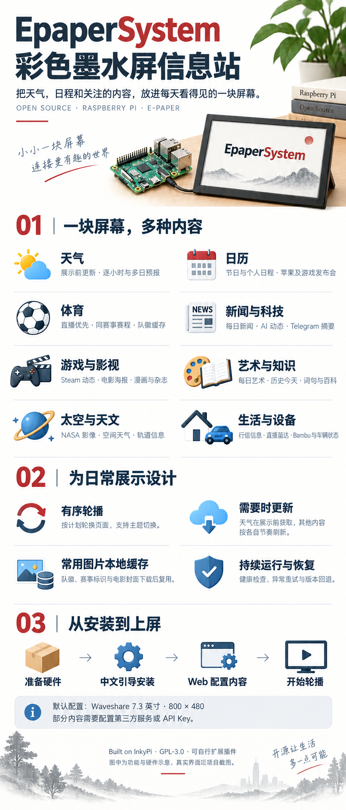

# EpaperSystem



EpaperSystem 是基于 **Raspberry Pi + 彩色墨水屏** 的开源信息站，把天气、日程、赛事和你关注的内容集中在一块屏幕上，通过局域网网页配置插件与轮播。

An open-source Raspberry Pi e-paper dashboard for weather, calendars, sports, news, culture and connected devices, with a web interface and configurable playlists.

介绍图是功能与硬件示意，下方的截图入口提供实机画面。部分内容需要配置第三方服务或 API Key。

## 内容

- **天气与日历**：天气在上屏前重新取数；日历整合节假日、个人日程、苹果与游戏发布会，按剩余空间补充后续事项。
- **体育**：一页分三个区域，每个赛事有自己的版式。
  - 上方足球：欧洲五大联赛、中超、世界杯与国家队比赛，附赔率、积分和后续赛程。
  - 左下赛事：NFL 转播式记分牌、MLB 每局比分、NBA / WNBA 对阵与系列赛、NCAA 前 25 名、PGA 排行榜、F1 比赛周末时间轴。直播优先，多场同时直播时每 10 分钟轮换。
  - 右侧电竞：英雄联盟 LPL / LCK / MSI / 世界赛、CS2、Dota 2 TI。直播优先，其余按谁先开赛；世界赛在比赛日（有直播或 24 小时内开赛）置顶。
  - 赛事专属标志随之出现，例如季后赛、总决赛、PGA 各站标志和 F1 赛道图。
- **资讯与科技**：每日 AI 新闻、Tech Pulse（Hacker News）、AI 生态动态、Telegram 摘要、今日报纸头版、RSS。
- **游戏、影视与直播**：Steam 个人资料与在线好友、Steam 热门榜、游戏优惠、LiveRadar 直播雷达（B 站 / 斗鱼 / Twitch）、英雄联盟 / Dota / 魔兽世界战绩、北美与中国票房、美剧热度。
- **艺术与知识**：每日艺术、Steam 艺术图、杂志与漫画封面、每日漫画、BacktotheDate 历史海报、每日维基、每日知识、每日词句、文学报时、维基每日图片、国家地理每日图片。
- **太空与生活**：NASA APOD 与空间天气、Orbital Signal（火箭发射与预测市场）、物种雷达、天空雷达、月相、股票、Bambu 打印机、车辆状态、湾区出行与潮汐、本地活动（Ticketmaster）。
- **自定义**：上传图片、相册与文件夹、Unsplash、网页截图、倒计时、年度进度、待办事项、GitHub 贡献图、电子宠物、AI 生成图文等。

## 网页与手机

- **局域网网页**：查看正在播放的画面，管理插件库和播放列表，按服务分组填写 API Key，调整设备设置。首次登录用安装时给出的一次性配对码设置管理员密码。
- **手机简报页（可选）**：[cloudflare/brief-reader](cloudflare/brief-reader) 是一个 Cloudflare Worker。设备每次换屏后，会把当前轮播的画面同步到这个需要登录的私人页面，手机上可以全屏、旋转、保持亮屏，像相框一样播放。

## 运行与维护

- 页面轮播、日夜主题自动切换、图片本地缓存。每个插件按自己的刷新策略更新，数据源暂时不可用时先显示缓存，之后自动重试。
- 自带健康检查（`/healthz`、`/readyz`）和 Wi-Fi 看门狗：长时间断网且反复重连失败时会自动重启设备，并有冷却时间，不会反复重启。
- 更新按版本安装到 `/opt/inkypi/releases`，并保留上一版本；更新中断或失败时，会恢复到原来的版本。

## 开始使用

先用 Raspberry Pi Imager 写入 Raspberry Pi OS Lite（优先 64 位），设置好 Wi-Fi、用户名和 SSH。登录树莓派后，粘贴这一条命令：

```bash
curl -fsSL https://raw.githubusercontent.com/Feeengyuuu/EpaperSystem/main/install.sh | sudo bash -s -- --lang zh-CN
```

按提示选择屏幕即可。默认是 **Waveshare 7.3 英寸彩色墨水屏，800 × 480，驱动 `epd7in3e`**，也可选择其他内置 Waveshare 驱动或 Pimoroni Inky。API Key 可以全部跳过，以后按需要添加。

安装完成后，按终端显示的局域网地址打开网页，用一次性配对码设置管理员密码，再选择插件、填写位置与内容、创建轮播。首次安装请按提示重启一次。脚本会检查环境、安装依赖并等待服务启动；在已有设备上重新运行时，会保留个人配置和密钥。

想先看看脚本，或只做环境检查，可以手动下载：

```bash
sudo apt-get update && sudo apt-get install -y git
git clone https://github.com/Feeengyuuu/EpaperSystem.git
cd EpaperSystem
bash install.sh --lang zh-CN --check
sudo bash install.sh --lang zh-CN
```

- [从零安装（简体中文）](inkypi-weather/package/InkyPi/docs/install_from_zero.zh-CN.md) · [Installation guide (English)](inkypi-weather/package/InkyPi/docs/install_from_zero.md)
- [API Key 获取与配置](inkypi-weather/package/InkyPi/docs/api_keys.zh-CN.md) · [API keys (English)](inkypi-weather/package/InkyPi/docs/api_keys.md)

## 开发

- 应用、插件和测试位于 `inkypi-weather/package/InkyPi`，Cloudflare Worker 位于 `cloudflare/`，共用工具位于 `tools/`。
- 本地使用 Python 3.11 和 Node 24。测试覆盖插件渲染、调度和网页交互，全部用模拟硬件运行；CI 会跑 ruff 和 pytest。
- 部署到设备用 `tools/release`：分块上传、健康门禁、真机写屏验收、备份轮换。

文档：[开发与本地测试](docs/development.md) · [编写插件](inkypi-weather/package/InkyPi/docs/building_plugins.md) · [Codex Cloud 远程开发](docs/codex-cloud.md)

## 界面截图

- [体育页面实机画面（2026-10）](inkypi-weather/package/InkyPi/docs/images/readme/screens/actual-sports-dashboard-800x480.png)
- [历史实机截图合集](inkypi-weather/package/InkyPi/docs/images/readme/epaper-system-real-screens.png)
- [插件展示墙](inkypi-weather/package/InkyPi/docs/images/readme/epaper-system-plugin-wall.png)

## 开源基础与许可

EpaperSystem 建立在开源 [InkyPi](https://github.com/fatihak/InkyPi) 之上，感谢原项目维护者和社区提供的应用、插件架构与安装体系。可运行的应用位于 `inkypi-weather/package/InkyPi`。

The InkyPi package is distributed under **GPL-3.0**. See [LICENSE](inkypi-weather/package/InkyPi/LICENSE).
